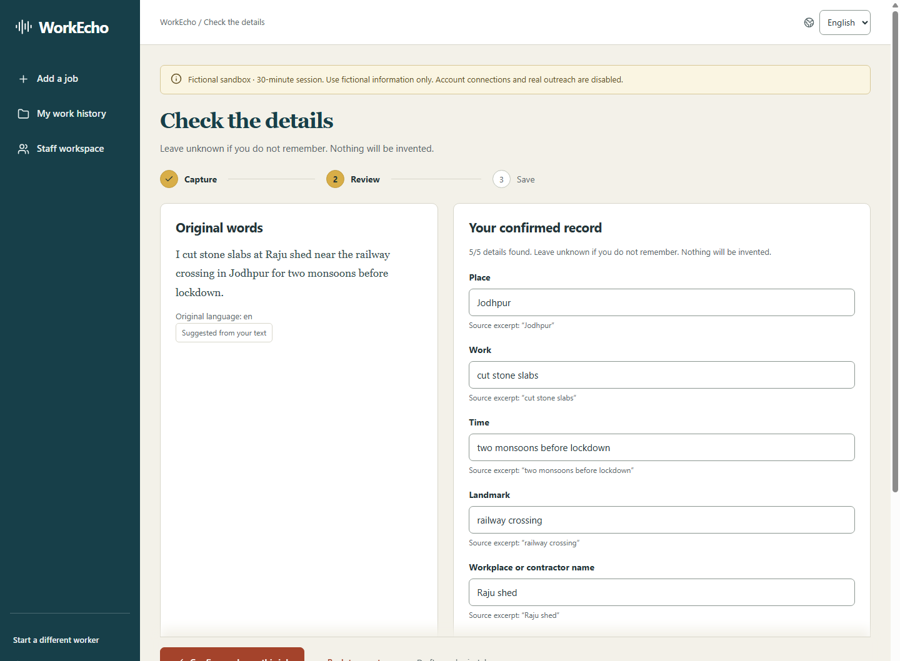
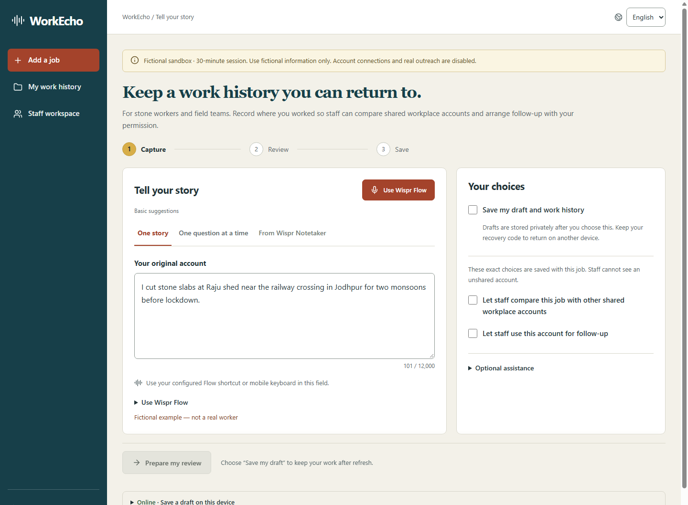
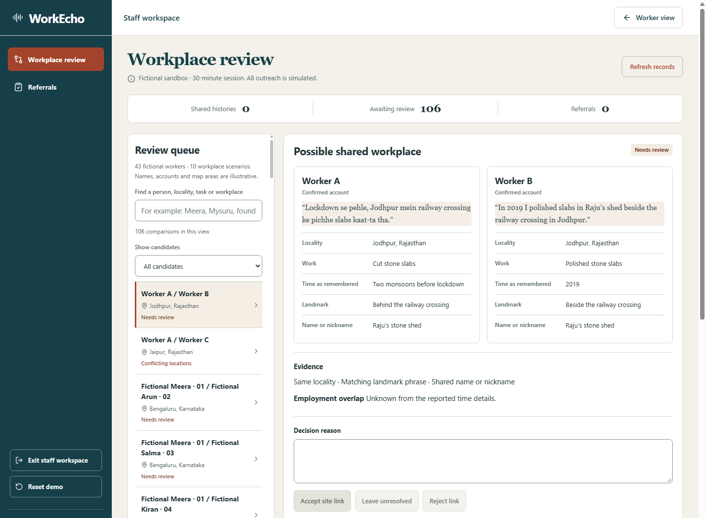

# WorkEcho — Scaler × Wispr Flow

**Voice-led work histories for stone-worker health outreach.**

**Track: Healthcare.** WorkEcho helps NGO field teams capture a worker's story with Wispr Flow, review five remembered details and investigate shared workplaces for silicosis-related follow-up.

[](https://github.com/ankith2409-web/scalerXwflow/actions/workflows/verify.yml)

## Open the app

| | |
| --- | --- |
| **[Live app](https://workecho-psi.vercel.app/)** | Hosted worker workspace and Wispr account connection |
| **[Worker demo](https://workecho-psi.vercel.app/?demo=1)** | Capture, review, confirm and reopen a fictional work history |
| **[Staff demo](https://workecho-psi.vercel.app/staff/review?demo=1)** | Compare fictional accounts and try a simulated referral |

The demo includes **43 fictional workers across 10 workplace scenarios**. Its 30-minute session notice is shown in the app.



<details>
<summary>See capture and staff comparison screens</summary>





</details>

## Why this matters

WorkEcho is designed for workers whose jobs may be remembered through a contractor's nickname, a railway crossing or a monsoon rather than formal employment records. Preserving those details helps a field team connect accounts and arrange consented follow-up.

In a project described in **ICMR's 2019–20 annual report**, **12% of about 350 screened sandstone miners had respiratory symptoms**. The project focused on early diagnosis and referral for silicosis. [Read the source, page 132](https://www.icmr.gov.in/icmrobject/custom_data/pdf/annual-reports/ICMR_AR_English_2019_20_final.pdf).

## Try it in three steps

1. Open the **worker demo** and choose **Try a fictional example**, or dictate fictional information with your installed Wispr Flow app. **One question at a time** offers guided entry.
2. Select **Save my draft and work history**, choose sharing and optional text-assistance permissions, then **Prepare my review**. Check **place, work, approximate time, landmark and workplace/contractor name** against the original words. Confirm the job and inspect the private return card.
3. Open the **staff demo**, select **Enter as demo staff** and inspect **Worker A / Worker B**. Record a workplace decision with a reason, then follow the simulated referral through its approval step.

The interviewer operates WorkEcho alongside the worker. First-person labels represent the worker's choices: read the details and sharing options back to them before confirmation.

## Built for Wispr Flow

- **Dictation:** focus a story or answer field and use the configured Wispr Flow shortcut or device keyboard. Flow supplies the text; WorkEcho turns it into a reviewable, consented work history.
- **Notetaker import:** **From Wispr Notetaker** in the live app connects a real account through OAuth with PKCE and retrieves a selected meeting transcript through the official Wispr MCP server.
- **Languages:** worker prompts support English, Hindi and Kannada. Original text and source excerpts stay in the worker's language.

## Text extraction and review

The hosted app and fictional demos offer **Gemini Flash structured extraction and display translation**, with provider-specific consent, source-excerpt validation and an unknown-answer filter. AI stays optional; the app displays the available extraction mode. [Hosted configuration and enforced quotas](docs/architecture.md#gemini-configuration-and-quotas) are documented separately.

The development regression set contains **25 typed fictional accounts**, including Hindi/English and Kannada/English mixtures. Each account has five expected field decisions; results use strict accepted-excerpt matching.

| Input group | Accounts | Rules: matched fields | Gemini: matched fields |
| --- | ---: | ---: | ---: |
| English | 7 | 34/35 (97.1%) | 34/35 (97.1%) |
| Hindi / Hinglish | 8 | 20/40 (50%) | 38/40 (95%) |
| Kannada / mixed English | 10 | 23/50 (46%) | 47/50 (94%) |
| Total | 25 | 77/125 (61.6%) | 119/125 (95.2%) |

The [evaluation details and observed outputs](docs/extraction-evaluation.md) show the method and remaining mismatches. [Fixtures](tests/fixtures/extraction-cases.json) are included for reproduction.

## Run from source

Docker provides a keyless evaluation of capture, review, saving, recovery and local staff access:

```sh
git clone https://github.com/ankith2409-web/scalerXwflow.git
cd scalerXwflow
docker compose up --build
```

Open the local address printed by the container. Docker preserves SQLite data in a named volume. Node.js contributors can use **24.12+**, then run `npm ci`, `npm run build` and `npm start`.

The interface uses React/TypeScript; the backend uses Node.js with SQLite locally and Neon PostgreSQL on Vercel. Supporting tools include recovery, export, sharing withdrawal, timelines, private files, optional maps, a workplace directory and case management.

**Suggested links are review leads for NGO staff, not automated employment proof or medical diagnoses.**

- [Architecture, integrations and configuration](docs/architecture.md)
- [Verification, regression coverage and limitations](docs/verification.md)
- [Operations and staff setup](docs/operations.md)
- [Demo recording guide](docs/demo-runbook.md)
- [Configuration example](.env.example), [schema](database/workecho.sql) and [migrations](database/migrations)
